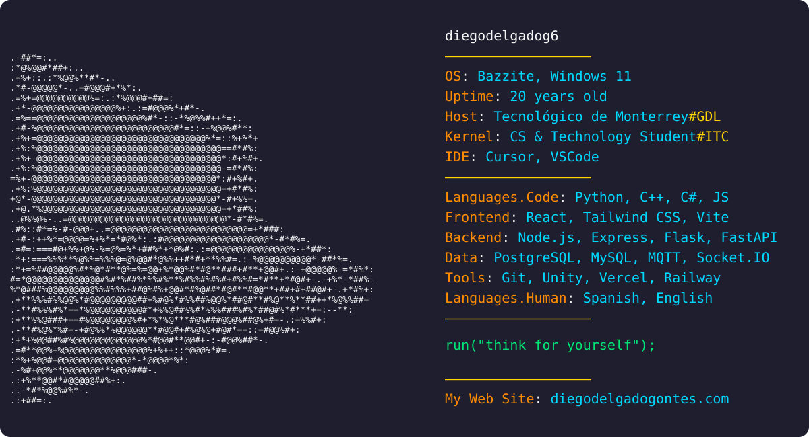

  <a href="https://diegodelgadogontes.com">Portafolio</a> ·
  <a href="https://www.linkedin.com/in/diegodelgadog6">LinkedIn</a>

Estudiante de Ingeniería en Tecnologías Computacionales en el Tecnológico de Monterrey (campus Guadalajara). Desarrollo aplicaciones web full-stack con React, Python y Node.js, y proyectos de IoT y videojuegos.

## Proyectos destacados

| Proyecto | Descripción | Stack |
| --- | --- | --- |
| [PaniniXchange](https://github.com/diegodelgadog6/paninixchange) · [demo](https://paninixchange.diegodelgadogontes.com) | Red social para intercambiar cromos del Mundial 2026 con coleccionistas cercanos | React, FastAPI, PostgreSQL |
| [Kueski Smart Widget](https://github.com/diegodelgadog6/kueski-extension) | Extensión de Chrome que detecta tiendas afiliadas y ofrece cupones, pago a quincenas y préstamos | JavaScript, Express, PostgreSQL |
| [AmpelIntelligence](https://github.com/diegodelgadog6/AmpelIntelligence) | Monitor IoT de tráfico y calidad del aire en tiempo real | ESP32, MQTT, Flask, MySQL |
| [Chatify](https://github.com/diegodelgadog6/chatify-app) · [demo](https://chatify.diegodelgadogontes.com) | Chat en tiempo real por canales ([backend](https://github.com/diegodelgadog6/Server-chatify)) | React, Socket.IO, PostgreSQL |
| [Postify](https://github.com/diegodelgadog6/ui-postify) · [demo](https://postify.diegodelgadogontes.com/profile/e4f72569-8304-4167-882c-c06d6b34da91) | Red social de publicaciones con imágenes ([backend](https://github.com/diegodelgadog6/Server-Postify)) | React, FastAPI, Cloudinary |
| [Arcane Kitchen](https://github.com/diegodelgadog6/Arcane-Kitchen) | Videojuego 2D de recolectar ingredientes y derrotar enemigos | Unity, C# |
| [Console Retro Game](https://github.com/diegodelgadog6/console-retro-game) | Consola retro para explorar Pokémon y combatir 1 contra 1 | React, Tailwind CSS, PokeAPI |
